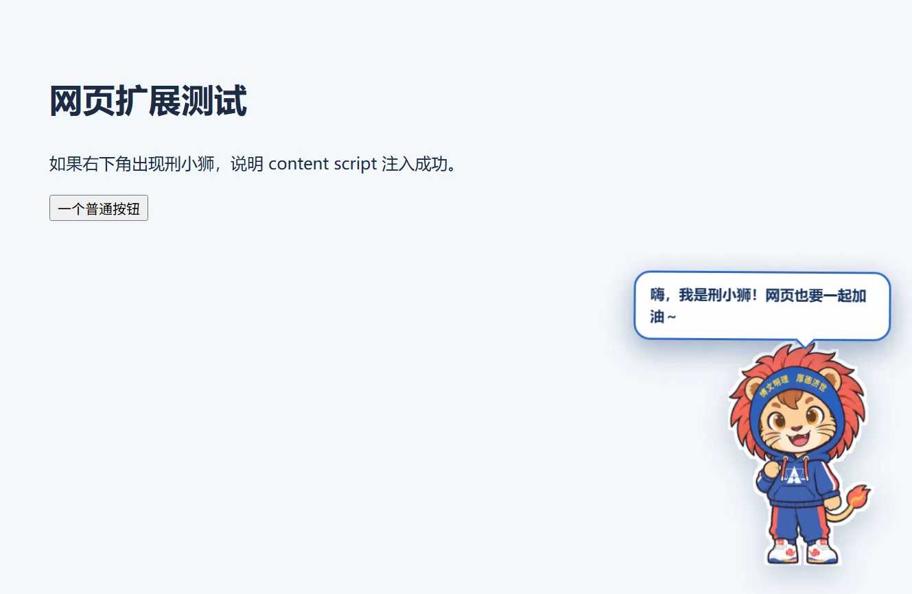

# dsh-lion-pet 🦁

把校徽里的那只刑小狮放进 **DeepSeek Harness** 的桌宠插件。


它不是一段静态贴图：刑小狮会呼吸、会自己散步、会转头看向行进方向；被拖起来会跟着鼠标晃，松手有惯性；点一下会弹跳、撒星星、说一句随机台词；右键可以点播动作、调大小、锁定位置、隐藏或叫回右下角。位置、大小和隐藏状态会记在浏览器里，下次打开还在原地。

## 功能

- **待机呼吸**：轻微的上下浮动和摆动，不抢注意力。
- **随机散步**：每隔一段时间在窗口下方溜达一小段，自动切换正面 / 侧面朝向。
- **点击回应**：摸摸头会弹跳、撒爱心和星星，并说出随机台词。
- **拖拽甩动**：按住拖动，松手保留速度，碰到窗口边缘会轻微反弹。
- **右键菜单**：摸摸头、散散步、转个圈、放大 / 缩小、锁定位置、回到右下角、隐藏。
- **隐藏与唤醒**：隐藏后右下角留一个圆形小头像，点一下就能叫回来。
- **记忆**：网页端把位置、大小、锁定和隐藏状态存进 `localStorage`；桌面端把窗口位置存在用户数据目录，下次打开还在原地。
- **桌面悬浮**：Electron 透明置顶小窗，可以拖到屏幕任意位置；鼠标移出窗口时自动点击穿透，不挡桌面操作。
- **显示模式**：DSH 设置 → 插件 → 刑小狮，可选「两者都显示 / 仅桌面 / 仅网页 / 关闭」。
- **网页通用版**：`extension/` 是 Chrome / Edge 的 MV3 扩展，安装后可以在任意 http(s) 网页右下角显示刑小狮。
- **不打扰**：不调用模型、不写会话、不产生 token 费用。
- **无障碍**：刑小狮可聚焦，Enter / 空格摸摸头，`M` 或菜单键打开右键菜单，Esc 关闭菜单。

## 安装

### 从 GitHub 克隆

```bash
git clone https://github.com/rumpen233/dsh-lion-pet.git
dsh plugin --profile desktop add file:<克隆目录的绝对路径>
```

例如 Windows 下：

```bash
dsh plugin --profile desktop add file:C:\Users\you\dsh-lion-pet
```

### 从本地目录安装（推荐）

```bash
dsh plugin --profile desktop add file:C:\path\to\dsh-lion-pet
```

安装后如果当前 profile 启用了 HMR，插件会热加载；否则重启 DSH 后生效。也可以在 DSH 的「插件」页选择「安装第三方插件」，填入本地目录的绝对路径。

### 手动安装

1. 把整个 `dsh-lion-pet` 目录复制到：

   ```text
   $DSH_HOME/profiles/desktop/node_modules/dsh-lion-pet
   ```

2. 在 profile 的 `package.json` 里加入依赖和组合包：

   ```json
   {
     "dependencies": {
       "dsh-lion-pet": "1.1.0"
     },
     "dsh": {
       "profile": {
         "bundles": ["dsh-lion-pet"]
       }
     }
   }
   ```

3. 重启 DSH。

## 使用

| 操作 | 效果 |
| --- | --- |
| 单击刑小狮 | 摸摸头：弹跳、撒星星、随机台词 |
| 按住拖动 | 搬家；松手有惯性，碰到边缘会反弹 |
| 右键 / 菜单键 | 打开动作菜单 |
| 滚轮？ | 不拦截页面滚动；请用菜单调大小 |
| 隐藏后点右下角头像 | 唤醒刑小狮 |

## 显示模式

打开 **DSH 设置 → 插件 → 刑小狮**，在「显示位置」里选择：

| 模式 | 效果 |
| --- | --- |
| 两者都显示 | DSH 页面内和桌面悬浮窗同时出现 |
| 仅桌面 | 只保留透明置顶的桌面窗口 |
| 仅网页 | 只在 DSH 的网页界面里出现 |
| 关闭 | 全部收起，不启动桌面 helper |

桌面模式依赖本机 Electron。插件会优先使用 `$DSH_HOME/electron/electron.exe`，也可以用环境变量 `DSH_LION_ELECTRON_PATH` 指定。首次切换后如果窗口没有出现，重启一次 DSH；host 侧代码不会热重载。

## 网页通用版

`extension/` 是一个独立的 Chrome / Edge MV3 扩展，和 DSH 插件分开安装：

1. 打开 `chrome://extensions`（Edge 为 `edge://extensions`），开启「开发者模式」。
2. 点「加载已解压的扩展程序」，选择本仓库的 `extension/` 目录。
3. 打开任意 http(s) 网页，右下角会出现刑小狮；点扩展图标可以关闭或恢复。

它和 DSH 的显示模式互不影响：DSH 设置控制「DSH 页面 + 桌面」，扩展控制「其他网页」。扩展只申请 `storage` 权限和网页注入权限，不读取页面内容。



## 配置

当前版本把网页端偏好保存在浏览器 `localStorage` 的 `dsh-lion-pet:v4` 键里：

```json
{
  "x": 1052,
  "y": 364,
  "size": 200,
  "hidden": false,
  "locked": false,
  "positioned": true
}
```

显示模式保存在 `$DSH_HOME/dsh-lion-pet/config.json`，例如：

```json
{ "display": "both" }
```

`display` 可取 `both` / `desktop` / `web` / `off`。桌面窗口自己的位置存在 Electron 用户数据目录的 `window.json`，一般不需要手动改。

想恢复默认，右键菜单选择「回到右下角」，或在 DevTools 里删除 `localStorage` 键后刷新页面。

## 素材

`assets/lion-front.webp` 与 `assets/lion-side.webp` 来自用户提供的校徽插画，经过抠图和白色贴纸描边处理；`assets/icon.png` 为插件列表头像。请在使用和再分发时遵守原图权利人的要求。

## 开发

```bash
# 重新把两张 webp 内联进 lib/client.js
node scripts/build.mjs

# 语法检查
node --check lib/client.js
```

源码在 `src/client.template.js`，构建脚本把 `__LION_FRONT__` / `__LION_SIDE__` 替换成 base64 data URL，并把 `src/index.js` 复制到 `lib/index.js`。浏览器半侧的宠物本体是纯 DOM + Shadow DOM；设置页按需加载宿主提供的 React，避免与宿主 UI 的样式和版本耦合。

桌面半侧在 `runtime/desktop-helper/`：一个 280×390 的透明置顶窗口，加载同一套狮子素材，通过 `preload.js` 暴露的 IPC 处理拖拽、点击穿透和退出。host 侧在 `src/index.js`，负责 `/dsh-lion-pet/config` 路由、配置文件和 helper 生命周期。

网页通用版在 `extension/`，不需要构建，直接在浏览器里「加载已解压的扩展程序」。

## 卸载

```bash
dsh plugin --profile desktop remove dsh-lion-pet
```

再从 profile 的 `dsh.profile.bundles` 里删掉 `dsh-lion-pet`，刷新页面。

## 许可证

- **代码**（`src/`、`lib/`、`scripts/` 及文档）：[MIT](LICENSE)
- **校徽与刑小狮插画**（`assets/`、`docs/`）：版权归原权利人所有，仅用于非商业展示与个人使用，**不在 MIT 授权范围内**。详见 [NOTICE](NOTICE)。

如果原图权利人不希望该素材出现在公开仓库中，请开 issue，会及时移除。

